# Eightfold user guide

Eightfold is a personal training app for a Hyrox race. It builds a plan that
counts down to race day and fits around your week, then helps you follow it:
today's session, fast logging, progress, benchmarks, a race simulator and live
heart rate from a chest strap. Everything stays on the phone.

The screenshots show [demo mode](#demo-mode), so the data in them is made up.

- [Setting up your race](#setting-up-your-race)
- [Today](#today)
- [Plan](#plan)
- [Logging a workout](#logging-a-workout)
- [Workouts outside the plan](#workouts-outside-the-plan)
- [Log](#log)
- [Progress](#progress)
- [Benchmarks](#benchmarks)
- [Race simulator](#race-simulator)
- [Goal splits](#goal-splits)
- [Heart rate](#heart-rate)
- [Morning check](#morning-check)
- [Backup](#backup)
- [Demo mode](#demo-mode)

## Setting up your race

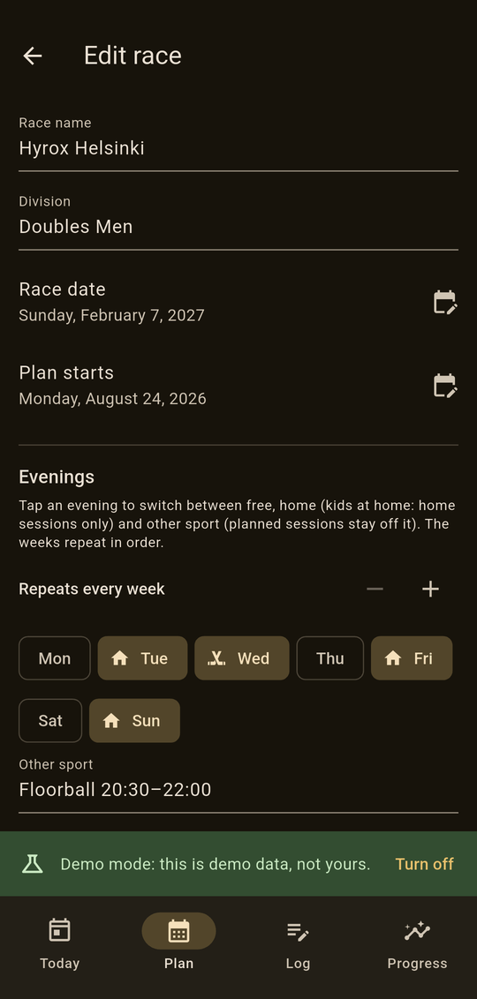

On first launch you enter the race: its name, division and date, and when
training starts. The plan runs from the start date to race day in Monday to
Sunday weeks.

**Evenings** describe your usual week. Tap a day to switch it between:

- **Free:** gym and run sessions go here.
- **Home:** only home sessions, such as evenings with the kids.
- **Sport:** another sport, such as floorball. It gets its own session, and
  planned training stays off it.

If your weeks differ, such as a two-week custody rhythm, use **+** to make the
schedule repeat every two weeks, or up to eight. Each week then has its own
row, and **Same as previous week** copies the week above it: four weeks of one
pattern and four of another is an eight-week schedule. **Week 1 starts** sets
which Monday the schedule counts from.

Saving builds the whole plan: base, build, race-specific and taper phases,
with a lighter deload week every fourth week. You can edit all of this later
from the race card at the top of the Plan tab.

## Today

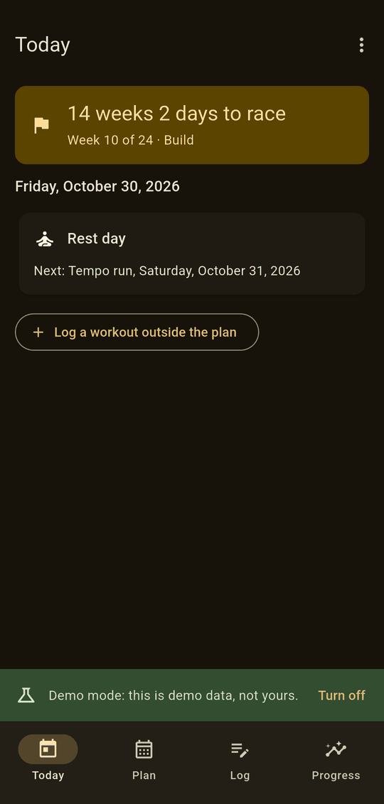

The top card counts down to the race and shows where you are: the week,
the phase and whether it is a deload week.

Below it is today's session as a checklist of its exercises. Tick them off as
you go, then:

- **Log workout** to record what you did (see below),
- **Complete** or **Skip** without logging,
- **Move** to another day. If that evening doesn't suit the session, for
  example a gym session on a home evening, the app asks first.

On a rest day it says so and shows the next session.

## Plan

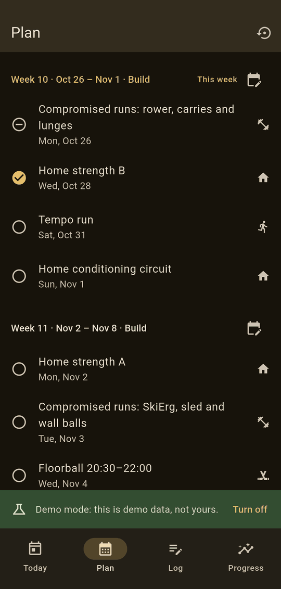 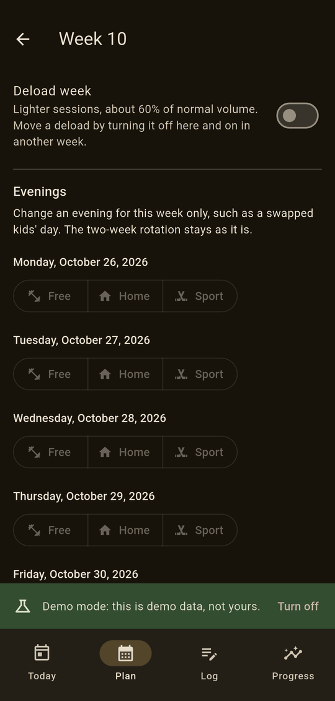

The Plan tab lists every week with its sessions, and opens on the current week.
Tap a session to see it in full.

Each week's calendar button opens that week:

- **Deload week:** turn it on or off, to move a lighter week (say, after
  being ill). The taper and past weeks can't be changed.
- **Evenings:** change a single evening for that week only, such as a swapped
  kids' day.

Before anything changes, you see which sessions would move, be added or be
replaced, and nothing happens until you confirm. Sessions you've done, logged
or moved by hand always stay as they are.

When a newer version of the app brings an improved plan, the Plan tab offers to
**update** your planned sessions from today on, again showing the changes
first.

## Logging a workout

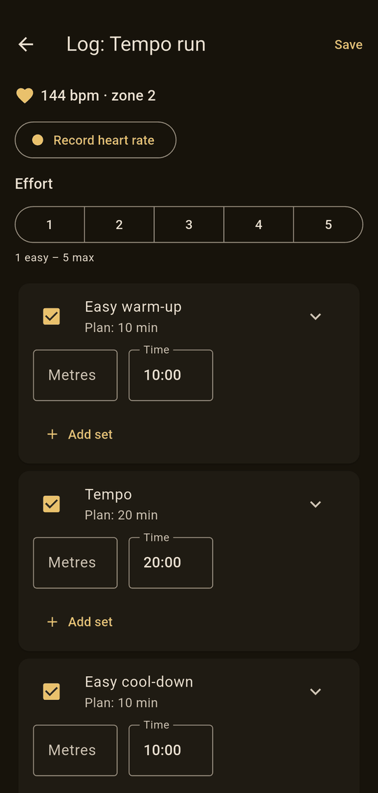 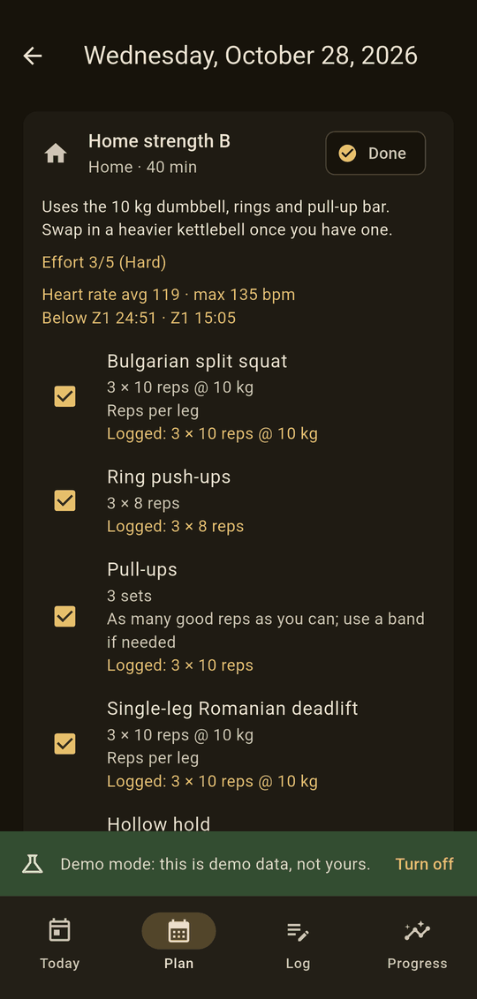

**Log workout** opens a form already filled in from the plan, so logging a
session as planned takes three taps: effort, then Save.

- **Effort** from 1 (easy) to 5 (max).
- Each exercise shows the fields that matter for it: reps and kilos for lifts,
  metres and time for runs. **More fields and notes** shows the rest.
- **Add set** adds a row for a ramp, such as 2 reps at 60 kg, 2 at 70 and 1
  at 80. Untick an exercise you skipped.
- With a heart rate strap connected, the live heart rate shows at the top and
  **Record heart rate** saves it with the log.

The session then shows what you logged, your effort and, if recorded, your
average and max heart rate and time in each zone. **Edit log** changes it;
**Delete log** removes it and plans the session again.

## Workouts outside the plan

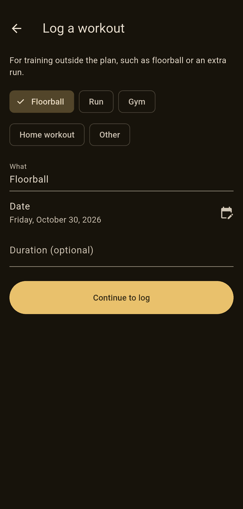

For training that isn't in the plan, such as floorball or an extra run, tap
**Log a workout outside the plan** on Today, or **Log a workout** on the Log tab.
Pick what it was, the date and how long, then log it like any session,
including heart rate.

These workouts show in the Log tab and count towards your weekly running, but
not towards how much of the plan you've done.

## Log

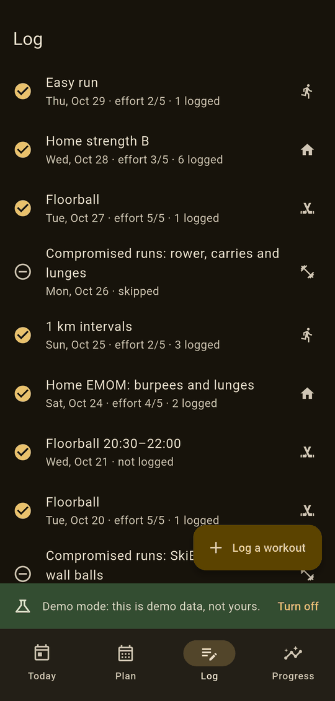

The Log tab lists everything you've done or skipped, newest first, with the
effort and how much was logged. Tap one to see it or edit its log.

## Progress

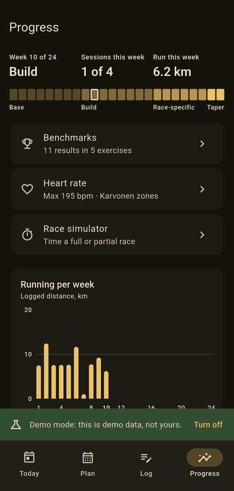 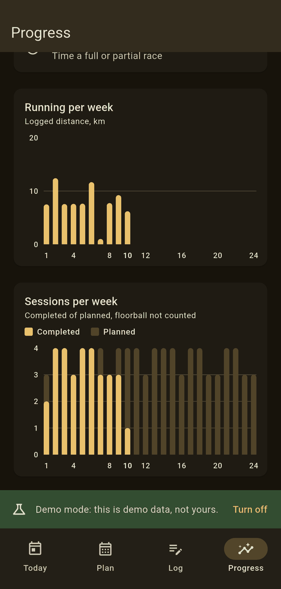

At the top: this week, how many sessions are done, and how far you've run. The
strip below shows the phases, with this week marked.

The charts show **running per week** (logged distance) and **sessions per week**
(done against planned; your other sport isn't counted). Tap a bar for its
numbers.

From here you also reach benchmarks, heart rate settings and the race
simulator.

## Benchmarks

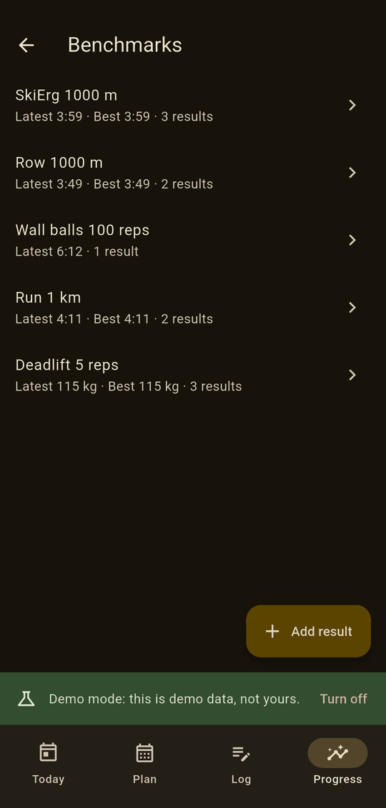 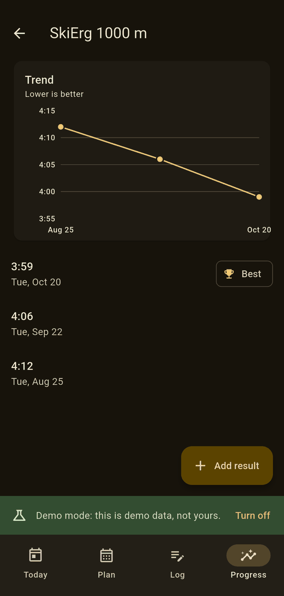

Record tests such as a SkiErg 1000 m time or a 5-rep deadlift: the eight
stations, 1 and 5 km runs and the main lifts, or anything else you name. Each
exercise shows its latest and best result, and a trend once it has two.

## Race simulator

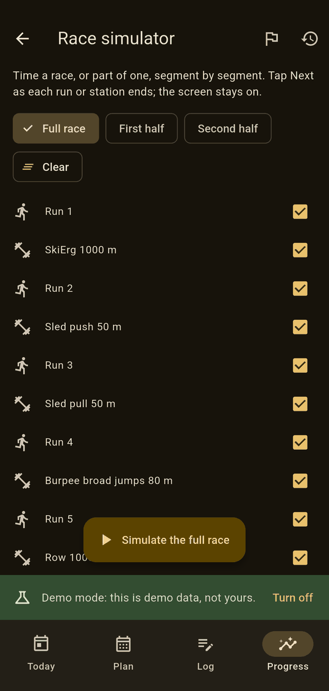 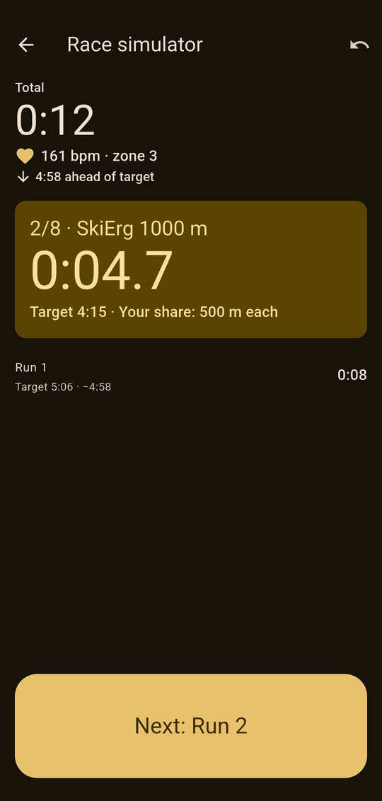

Time a full race, either half, or any segments you pick (**Clear** unticks them
all). The run screen has one big button: **Start**, then **Next** as each run
or station ends, then **Finish**. **Undo** takes back a mistaken tap.

The screen stays on while it runs, and the times stay right if you switch apps,
lock the phone or the app is closed. With a strap, heart rate is recorded too,
and with [goal splits](#goal-splits) each segment shows its target and your
share.

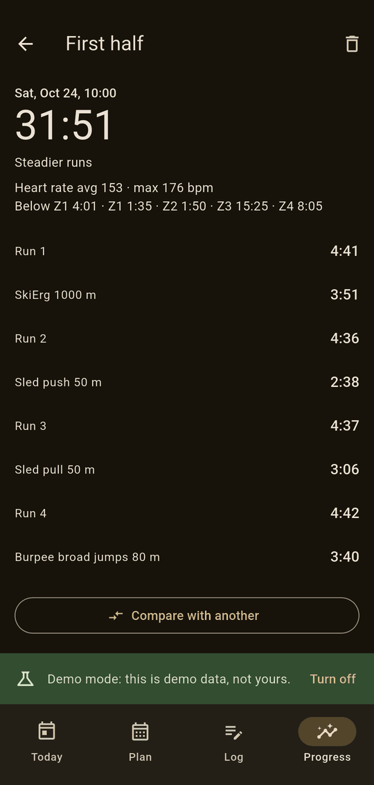 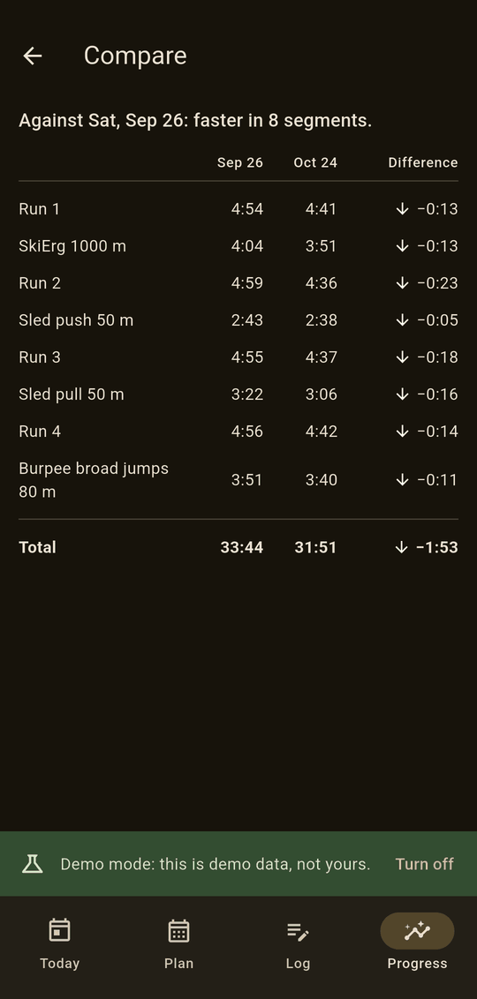

Save a finished simulation with notes. Saved ones list newest first, and any
two can be compared segment by segment: which got faster or slower, and by
how much.

## Goal splits

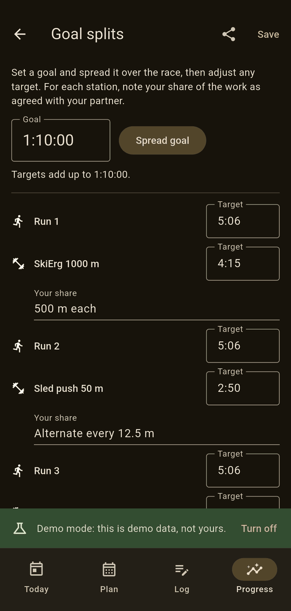

Set a goal time and **Spread goal** shares it across the 16 segments; adjust
any target after. For each station, write down your share of the work as
agreed with your partner, such as *500 m each*. **Share with partner** sends
the plan as text.

## Heart rate

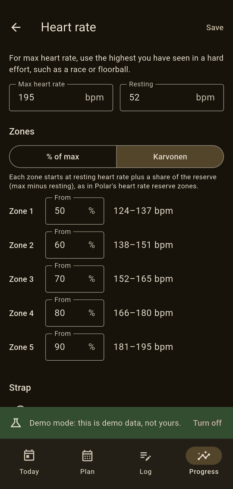

Set your **max heart rate**, and your **resting** heart rate if you use
Karvonen zones. Zones are either a share of max, or Karvonen: resting plus a
share of the reserve (max minus resting), as in Polar's heart rate reserve
zones. Each zone's range shows in bpm.

**Find a strap** connects a chest strap such as the Polar H10 over Bluetooth.
Put the strap on (it wakes when the electrodes are moist), pick it from the
list and save. The app asks for Android's *Nearby devices* permission the first
time, and never for location.

The live heart rate then shows when logging and in the simulator. It says
**No skin contact** when the strap is off and **Strap disconnected** if the
connection drops, and reconnects by itself.

## Morning check

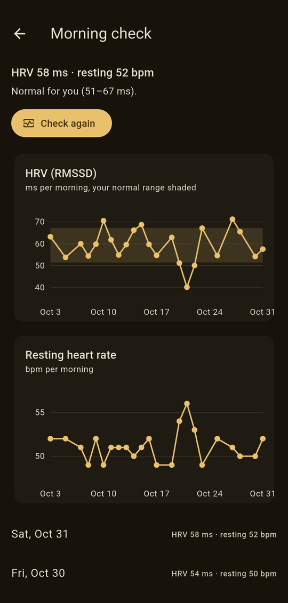

With a strap, Today has a **Morning check** card. Soon after waking up, put
the strap on, lie still and tap **Check now**: after 30 seconds to settle, the
app measures for 2 minutes. It shows your **HRV** (heart rate variability, as
RMSSD in milliseconds) and your **resting heart rate**.

After five checks, the app knows your normal range from the last 30 days, and
says how today compares: *normal for you*, *higher than usual*, or *lower than
usual: consider an easier day*. A low HRV often follows hard training, poor
sleep or a coming cold. Tap the card for the trend over the weeks.

Lie still for the whole check. If too many beats are missed, for example when
the strap is dry, the app asks you to try again. A second check on the same
day replaces the first.

## Backup

The Plan tab's backup button exports everything to one file through the
Android share sheet, for example to Drive or email. **Restore from backup**
replaces all data with a backup file after asking first. On a fresh install,
the setup screen has **Restore** too.

## Demo mode

To show the app without your own data, turn on **Demo mode** from the ⋮ menu on
Today. The app then shows a plan well under way, with logs, heart rate,
benchmarks and simulations, and a demo strap for live heart rate.

Demo data lives separately: your own data isn't touched, and turning demo mode
off (from the menu or the banner) brings it back as it was. **Reset demo data**
starts the demo afresh from today. Backups are off in demo mode.
